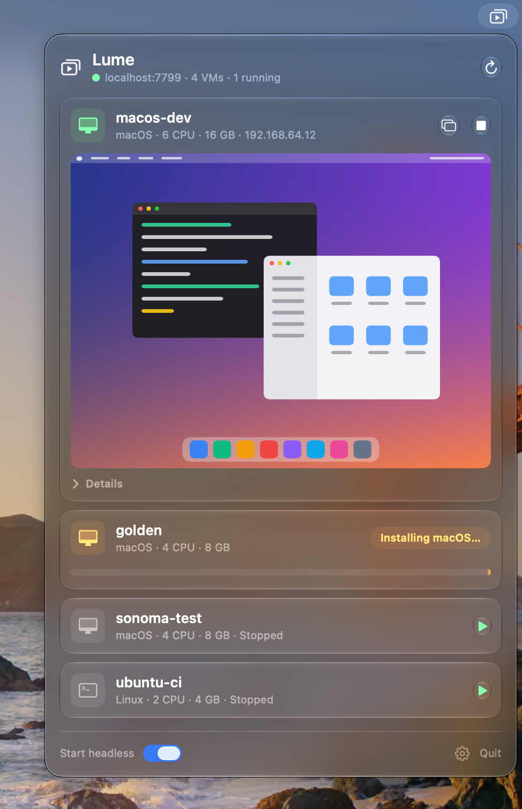
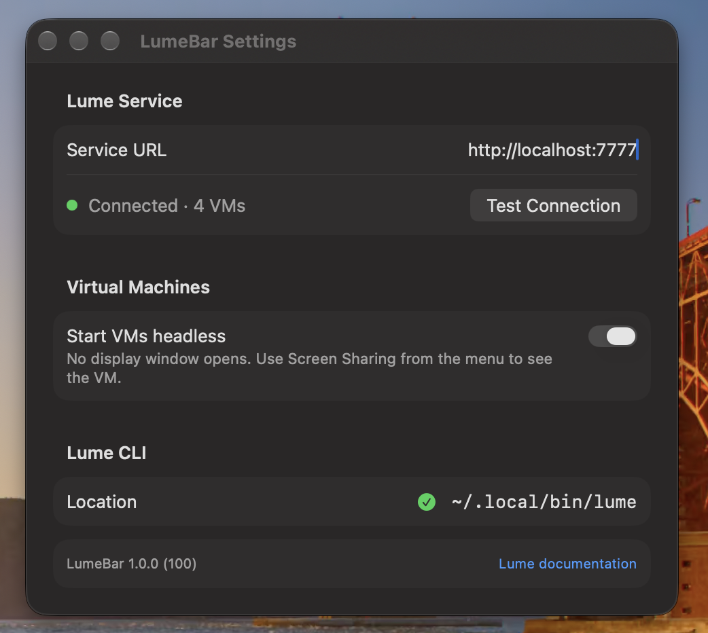

<p align="center">
  
</p>

<h1 align="center">LumeBar</h1>

<p align="center">
  Your <a href="https://cua.ai/docs/lume/guide/getting-started/quickstart">Lume</a> virtual machines, one click away in the macOS menu bar.
</p>

<p align="center">
  
</p>

Release status: `1.0.0-beta`

## Features
- **See everything at a glance:** every VM with its OS, CPU, memory and IP, running VMs on top, plus a live service status in the header
- **Start and stop in one click** using the local `lume` CLI, headless or with a display
- **Live previews:** a VNC snapshot of each running VM when you open the menu; double-click it to open Screen Sharing
- **Provisioning progress:** VMs that are still installing show what they're doing instead of a Start button
- **Right-click a VM** to start it headless or with a display, open Screen Sharing, or copy its name or IP
- **Details on demand:** disk, storage, display and creation date behind a single disclosure

<p align="center">
  
</p>

## Requirements
- macOS 26+
- Swift 6.2 (SwiftPM) with full Xcode installed (Command Line Tools alone can't compile the asset catalog)
- Lume CLI installed and available at runtime (for start/stop)
- Lume service running locally for list/details APIs (default `http://localhost:7777`)
- Lume docs: https://cua.ai/docs/lume/guide/getting-started/quickstart

## Getting Started
1. Ensure the Lume service is running locally. The app will attempt to start it by running `lume serve` if it cannot connect.
2. Build the app:

```bash
swift build -c release
```

3. Run the app:

```bash
swift run LumeBar
```

## Package as a `.app`
Create a local app bundle and zip archive:

```bash
scripts/package-app.sh
```

Artifacts:
- `dist/LumeBar.app`
- `dist/LumeBar.zip`

For signed distribution (Developer ID + notarization):

```bash
scripts/sign-and-notarize.sh \
  --identity "Developer ID Application: Your Name (TEAMID)" \
  --keychain-profile "<notarytool-profile>"
```

## Configuration
- **Service URL:** set in Settings (default `http://localhost:7777`). Use Test Connection to check it, and Reset to Default to go back.
- **Start headless:** switch in the menu's footer or in Settings to start VMs without a display window.
- **Lume CLI:** Settings shows which `lume` binary LumeBar found.

## App icon
The app icon and menu bar symbol are drawn as SVG in `design/icon/`. After editing them, regenerate the asset catalog PNGs:

```bash
swift scripts/render-icons.swift
```

## Troubleshooting
- If Start/Stop shows `no such file or directory`, ensure `lume` is installed. LumeBar looks in your `PATH`, `~/.local/bin`, `/opt/homebrew/bin` and `/usr/local/bin`; Settings shows which one it found.
- If VM thumbnails appear black during early boot, wait for guest display initialization and reopen the menu to refresh snapshots.

## Third-Party Notices
See `THIRD_PARTY_NOTICES.md`.

## License
MIT. See `LICENSE`.
